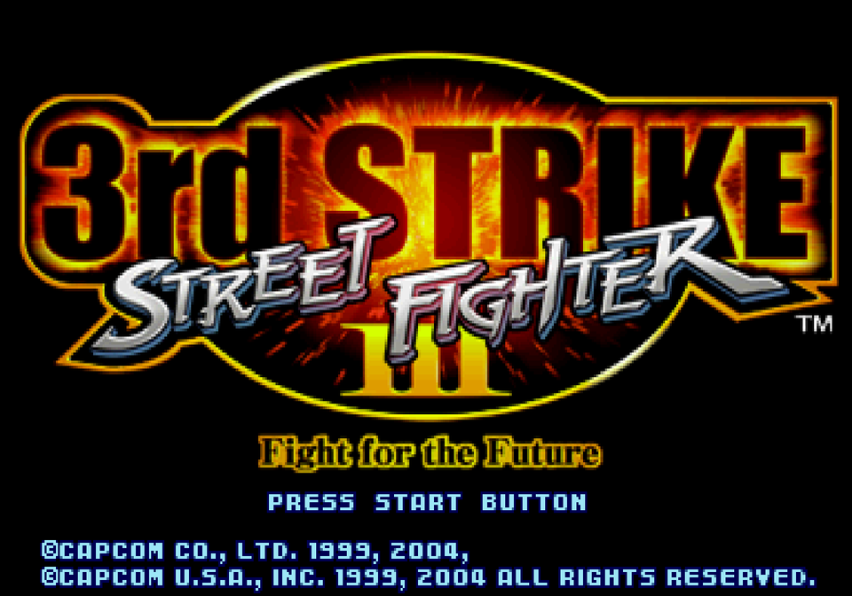
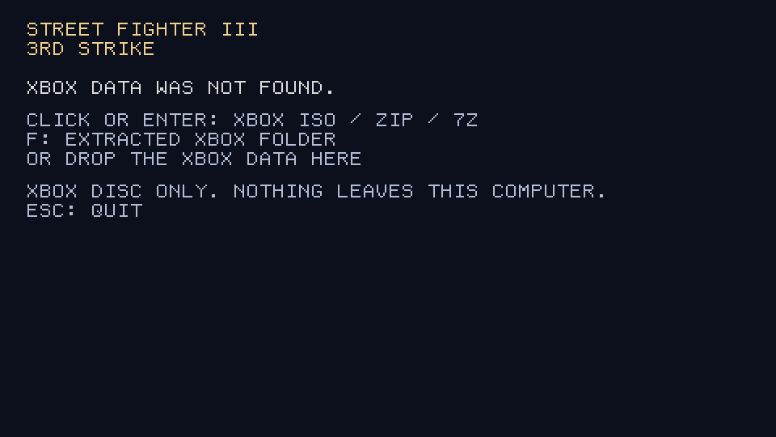
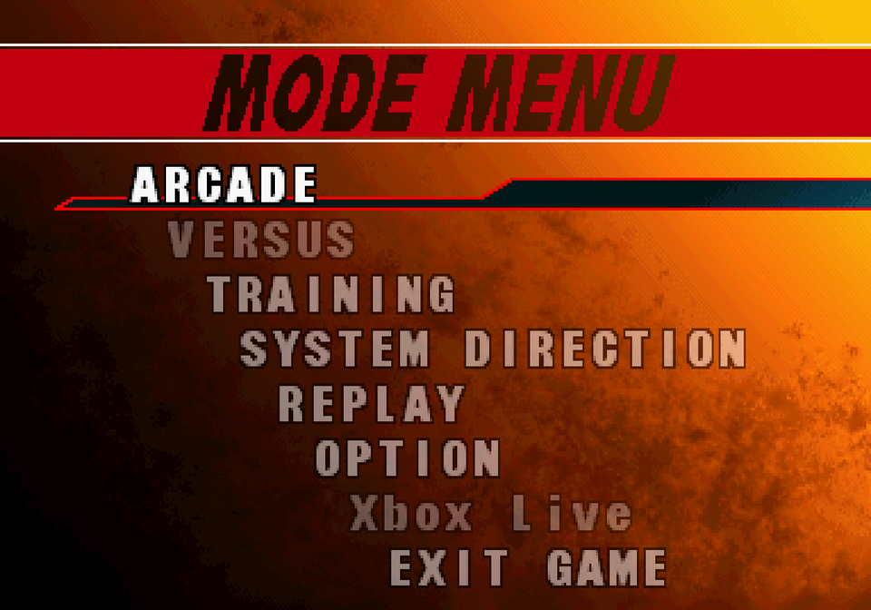
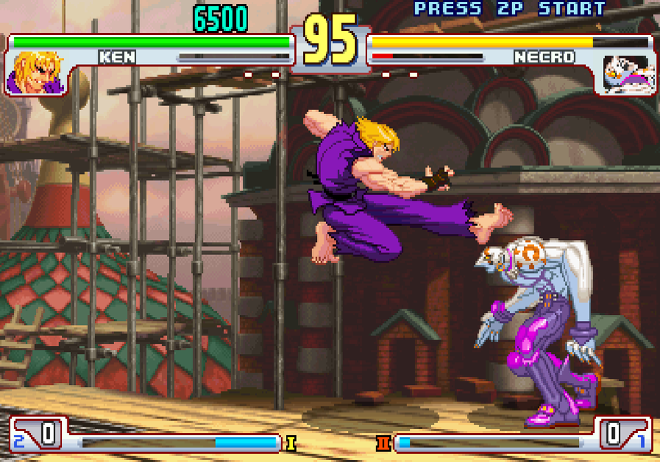
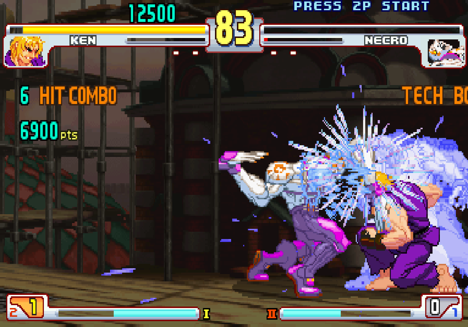
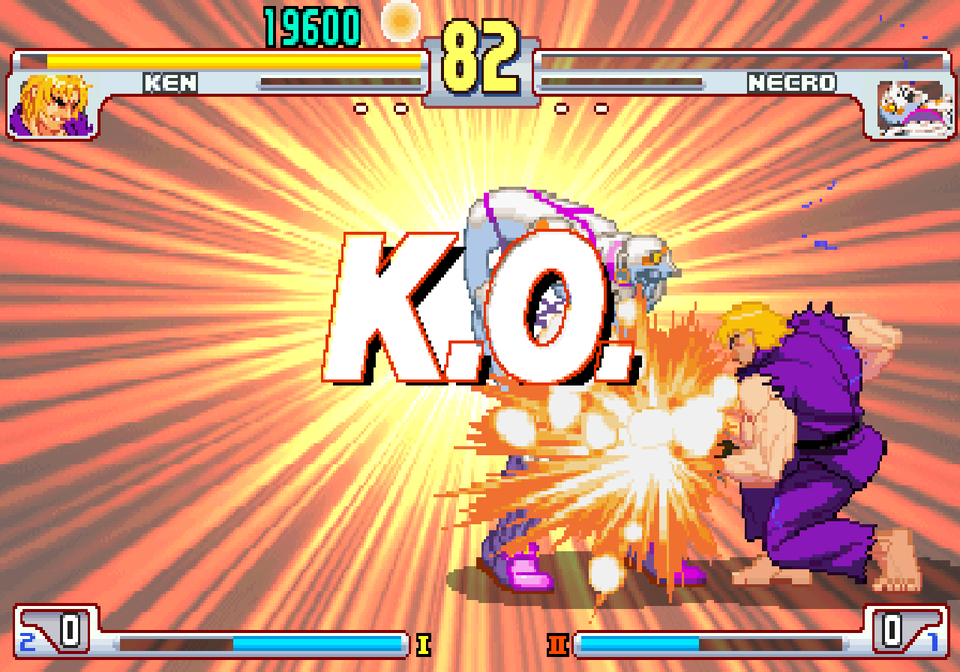

# SF33RDSXBRecompo

Native x86-64 port of Street Fighter III: 3rd Strike, built from the Xbox version, for Linux and Windows.



The game logic is the C of [3s-decomp-ogxb](https://github.com/Manya3084/3s-decomp-ogxb), compiled for x86-64. Everything the Xbox provided under it is written natively here: SDL3 for the window, input and timing, a Vulkan renderer for the game's draws (OpenGL 3.3 where Vulkan is missing), OpenAL for sound, and plain files for the disc archive and the saves. No Xbox code is built. There is no Xbox heap, XDK, xboxkrnl, D3D8, CRI middleware, XACT or XOnline dependency. The XBE is read once, at import, for the sound effects' cue tables; nothing from the disc is in this repository. [docs/porting.md](docs/porting.md) describes how the pieces fit.

## Status

Working:

- the boot logos, the opening and attract demos, the title screen and menus
- Arcade, character select, and fights, including the attract-loop fights
- music: the ADX and AIX tracks, decoded natively and streamed through OpenAL
- sound effects and voices: the game's XACT cue banks played on OpenAL (PCM and Xbox ADPCM waves, loops, envelopes, fades, panning, the pitch LFO's vibrato)
- saves (system settings and button directions) in `data/save/`, and replays in ten slots (`replay01.sav` to `replay10.sav`), picked on the game's REPLAY screens
- the keyboard and SDL3 gamepads, with retail's join-by-Start, and a keyboard page in BUTTON CONFIG for rebinding the keys
- windowed, borderless or fullscreen, the resolution and the aspect ratio, set in SCREEN ADJUST, paced to 60 frames a second; the 448-line game area fills the window's height
- Vulkan, or OpenGL 3.3 when Vulkan is missing (`SF_RENDERER=opengl` picks it)
- EXIT GAME in the mode menu (retail's SELECT GAME), which quits cleanly

Not done yet:

- online play (the game runs offline; Xbox Live is greyed out in the mode menu)

## Download

The [releases](https://github.com/Manya3084/SF33RDSXBRecompo/releases) have a Windows and a Linux package. Neither has any game data: the game imports your own Xbox disc the first time it starts (see [Running](#running)).

**Windows** (64-bit Windows 10 or 11):

1. Download `sf33rdsxb-windows-x86_64.zip` and unzip the whole folder somewhere you can write to, such as Documents or the Desktop. Not Program Files: the game keeps its data and saves next to `sf33rdsxb.exe`.
2. Run `sf33rdsxb.exe`. The program is not signed, so Windows may say "Windows protected your PC": click More info, then Run anyway.
3. Pick your Xbox disc image, zip or 7z in the window that opens.

It needs a graphics driver with Vulkan or OpenGL 3.3. The DLLs it uses are in the folder.

**Linux** (glibc 2.39 or newer: Ubuntu 24.04, Debian 13, Fedora 40 or later):

1. Install OpenAL, libarchive and the Vulkan loader:
   - Ubuntu/Debian: `sudo apt install libopenal1 libarchive13t64 libvulkan1`
   - Fedora: `sudo dnf install openal-soft libarchive vulkan-loader`
   - Arch: `sudo pacman -S openal libarchive vulkan-icd-loader`
2. Unpack `sf33rdsxb-linux-x86_64.tar.gz` and run `./sf33rdsxb` in it. SDL3 is included (`lib/`).

## Getting the data

The game data comes from your own copy of the Xbox disc. `sf33rdsxb` imports it, either on first launch or with:

```
sf33rdsxb --extract SOURCE --data DIR
```

`SOURCE` is one of:

- an Xbox XDVDFS disc image;
- a zip or 7z archive of that disc (the image itself, or the extracted Xbox tree);
- the extracted Xbox folder (`sf33rd.xbe` and `XB_HostPC/SF33RDXB.AFS`).

Anything else is refused, including a PlayStation 2 disc packed in a zip or 7z. The reader looks for the Xbox volume id `MICROSOFT*XBOX*MEDIA` and for `XB_HostPC/SF33RDXB.AFS`. It copies the 3rd Strike archive, the opening AIX, the fonts and the NV2A shaders, and reads the 21 sound banks (the sound effects' cue tables) out of `sf33rd.xbe`. It does not keep the XBE or copy the SF2 movies.

Data imported before the sound banks were can get them on their own:

```
sf33rdsxb --sound-banks /path/to/sf33rd.xbe --data DIR
```

Never commit anything under `data/`. It is the game itself.

## Running

```
sf33rdsxb            (Linux)
sf33rdsxb.exe        (Windows)
```

The first time, the window asks for your Xbox disc:



- click the window (or press Enter) and pick the disc image, or a zip or 7z of it;
- or press F and pick the extracted disc folder (the one holding `sf33rd.xbe` and `XB_HostPC`);
- or drop any of those on the window.

It imports the game into `data/` next to the program (about 1.3 GB) and starts it. The next time, it starts straight away. Only the Xbox disc works; a PlayStation 2 image is refused with a message saying so. Data imported before the sound effects were read from `sf33rd.xbe` is asked for again.

## Screenshots

| | |
|---|---|
|  |  |
|  |  |

## Controls

Players join the way they did on the Xbox: press Start on any pad.

| Xbox     | Keyboard  |
|----------|-----------|
| d-pad    | arrows    |
| A, B     | Z, X      |
| X, Y     | A, S      |
| White    | Q         |
| Black    | E         |
| L, R     | W, R      |
| Start    | Enter     |
| Back     | Backspace |

Those are the keyboard's defaults. In OPTION → BUTTON CONFIG, F1 opens the keyboard page: pick a button with the arrows, press Enter, then the new key (a key already in use swaps over). Esc goes back. The page always uses the arrows, Enter and Esc, whatever the bindings.

The keyboard is port 0. Gamepads take ports 1 to 3 in the order SDL3 reports them, and they are read even when the window is not focused.

## Display

OPTION → SCREEN ADJUST has three rows after FILTER:

- WINDOW MODE: WINDOWED, BORDERLESS (the desktop's size) or FULLSCREEN (a mode of the display).
- RESOLUTION: the window's size, or the fullscreen mode. The list is the display's modes and the 4:3 sizes that fit it. Borderless always uses the desktop.
- ASPECT RATIO: 4:3 (the original, with bars at the sides), 16:9 (widened), or FULL (the whole window).

DEFAULT SETTING puts them back to a 1280×960 window at 4:3.

## Layout

```
data/afs/SF33RDXB.AFS     the disc archive, read in place
data/afs/index            its members: index name bytes
data/afs/files/           the members, unpacked under their stored names
data/audio/ST3_3_OP.aix   the opening theme
data/audio/sdbk/          the sound effects' cue tables, 00.sdbk to 20.sdbk
data/fonts/
data/save/                system.sav, directions.sav
data/last_session.input   the last session's inputs, for replaying a bug
data/crash.log            the backtrace of the last crash
config/keyboard.txt       the keyboard's bindings
config/display.txt        the window mode, resolution and aspect ratio
```

## Build

```
cmake -S . -B build -DSF_DECOMP_DIR=/path/to/3s-decomp-ogxb
cmake --build build
ctest --test-dir build --output-on-failure
```

Requirements:

- SDL3, Vulkan, OpenAL, OpenGL, zlib and libarchive;
- `glslc`, to compile the shaders;
- Python 3, for the build's code generators.

For Windows, cross-built with MinGW-w64 from Linux:

```
cmake -S . -B build-win -DCMAKE_TOOLCHAIN_FILE=cmake/mingw-w64.cmake \
    -DSF_WIN_SYSROOT=/path/to/mingw64 -DSF_DECOMP_DIR=/path/to/3s-decomp-ogxb
cmake --build build-win
```

`SF_WIN_SYSROOT` is a MinGW-w64 root with SDL3, OpenAL, libarchive, zlib and the Vulkan loader (the MSYS2 `mingw-w64-x86_64-*` packages, unpacked). The DLLs the exe needs go next to it.

The Linux release package is built by [.github/workflows/linux.yml](.github/workflows/linux.yml) on Ubuntu 24.04.

`SF_DECOMP_DIR` is a checkout of 3s-decomp-ogxb (default `../3s-decomp-ogxb`). Until it is merged, that checkout must be on its `xbox-port-data` branch. The port is 64-bit-only and links non-PIE (see [docs/porting.md](docs/porting.md#x86-64)).

`SF_SCALE=N` fixes the render scale, and `SF_COUNTRY=1..4` picks the region. The debugging switches (headless runs, input replay, frame captures) are listed in [docs/porting.md](docs/porting.md#debugging).
